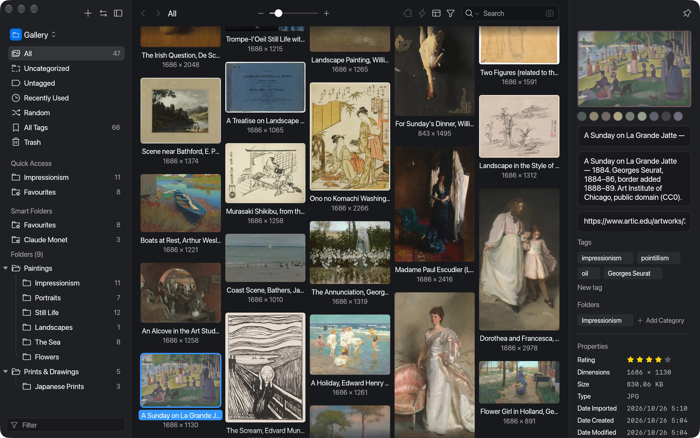
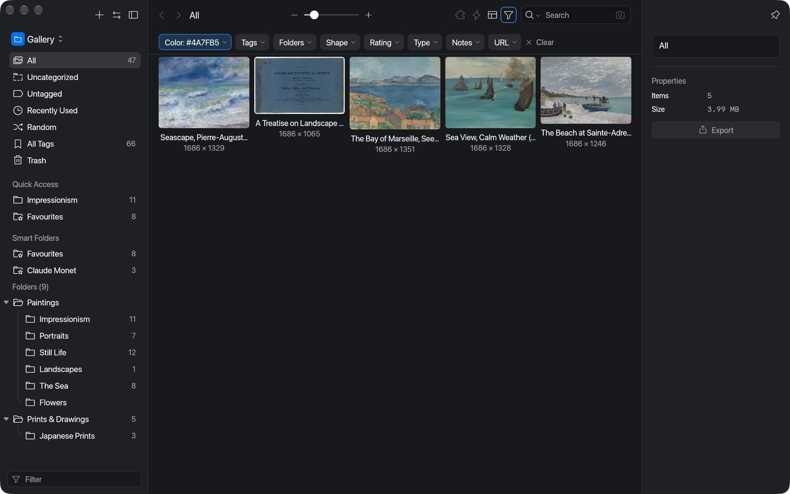
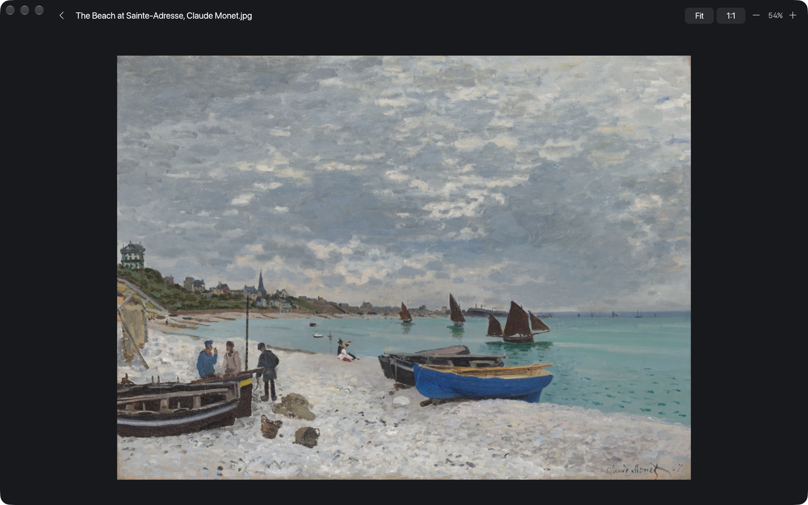
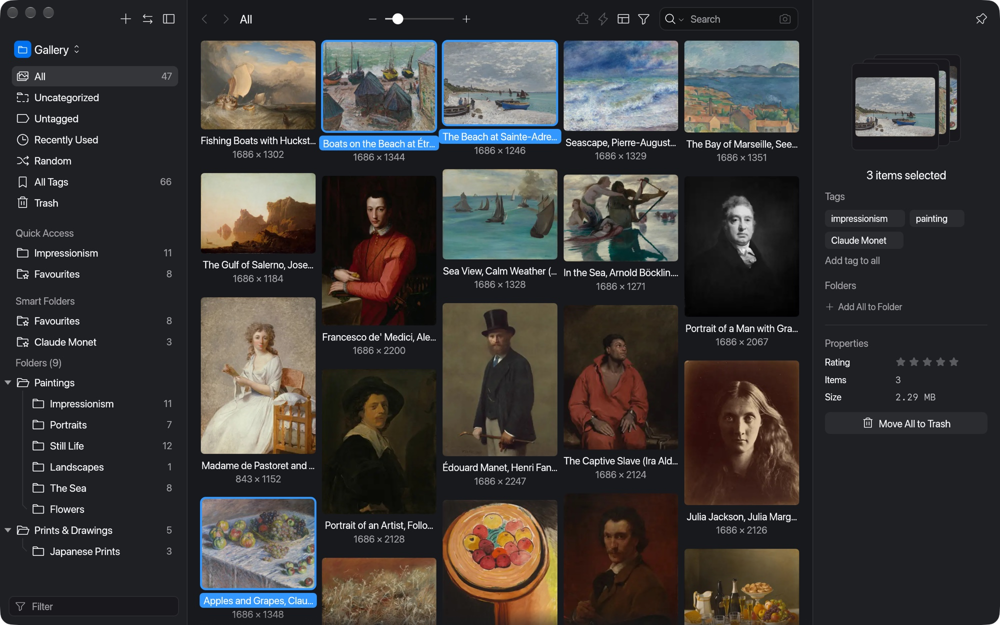
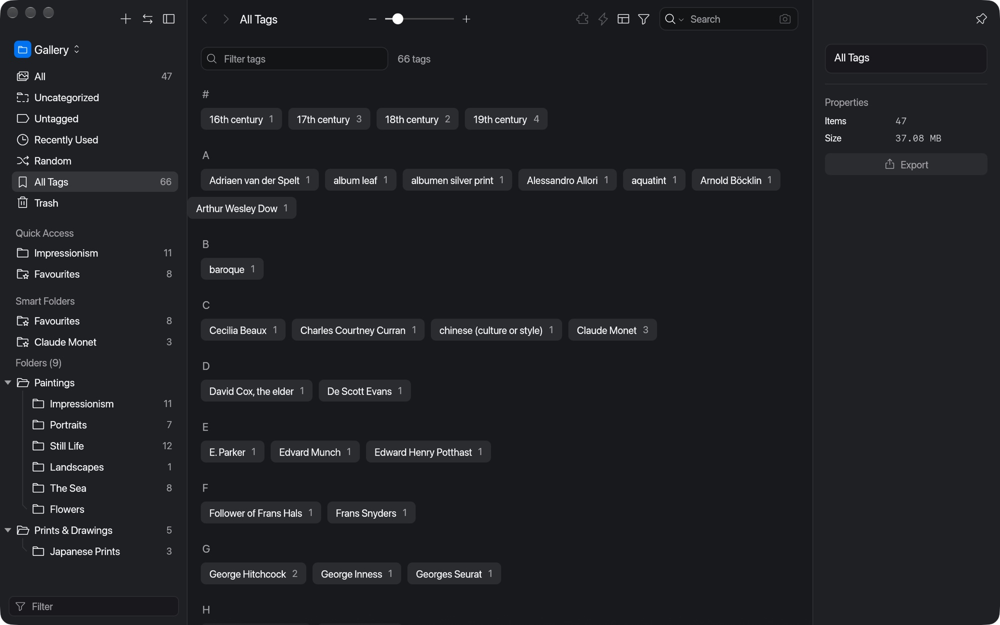
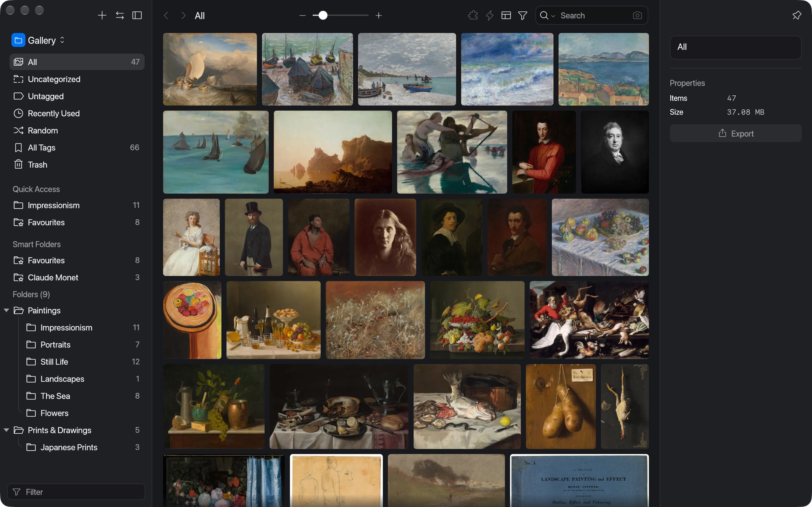

<p align="center">
  
</p>

<h1 align="center">Falcon</h1>

<p align="center">
  <b>An open-source asset manager for everyone, written in pure Rust.</b><br>
  Collect, tag, search and browse images, PDFs, fonts and videos in one library,<br>
  in a native app that is free, offline and yours.
</p>

<p align="center">
  
  
  
  
</p>

<p align="center">
  <a href="https://ahmedkhan-gh.github.io/falcon/"><b>Website</b></a> ·
  <a href="https://ahmedkhan-gh.github.io/falcon/book/">Documentation</a> ·
  <a href="ROADMAP.md">Roadmap</a>
</p>

<br>

<p align="center">
  
  <br>
  <sub>A library of public-domain paintings in the Waterfall layout, with the inspector open on the selected work.<br>
  <i>A Sunday on La Grande Jatte — 1884</i>, Georges Seurat, 1884–86</sub>
</p>

<p align="center">
  <a href="#features">Features</a> ·
  <a href="#get-started">Get started</a> ·
  <a href="#under-the-hood">Under the hood</a> ·
  <a href="#status">Status</a> ·
  <a href="#license">License</a>
</p>

<br>

<table>
  <tr>
    <td width="25%" valign="top">
      <h3>📥 Collect anything</h3>
      Drag files in, paste with ⌘V, or open files with the app. Thumbnails and colour palettes are made for you. PDF, video, PSD, AI, HEIC and RAW come in through macOS QuickLook.
    </td>
    <td width="25%" valign="top">
      <h3>🗂️ Organise your way</h3>
      Nested folders, tags, smart folders, ratings, notes and Quick Access. Edit tags across hundreds of items at once, and rename or merge tags across the whole library.
    </td>
    <td width="25%" valign="top">
      <h3>🔎 Find it again</h3>
      Search by keyword with AND, OR and NOT, filter by colour, shape, type and rating, or find images by colour similarity.
    </td>
    <td width="25%" valign="top">
      <h3>⚡ Native and fast</h3>
      Written in Rust with egui. No Electron and no web view. Thumbnails decode on worker threads, and 40 large images import in under three seconds.
    </td>
  </tr>
</table>

<br>

## Features

Every screenshot here is the real app at work on public-domain art. The credits are in [ATTRIBUTION.md](ATTRIBUTION.md).

<table>
  <tr>
    <td width="50%" valign="top">
      
      <br>
      <sub>A colour filter for blue, finding the sea paintings.</sub>
      <h3>Search by colour</h3>
      Every image gets a dominant-colour palette when it is imported. Pick a colour, or click a swatch in the inspector, to find images with that colour, sorted by how close they are (CIEDE2000). Combine it with tags, folders, shape, rating, type, notes and URL filters.
    </td>
    <td width="50%" valign="top">
      
      <br>
      <sub>The full-window viewer.<br><i>The Beach at Sainte-Adresse</i>, Claude Monet, 1867</sub>
      <h3>A viewer that keeps up</h3>
      Zoom around the pointer, pan, fit or show actual size, and step through the library with the arrow keys. Animated GIFs play, and PDFs and other documents render at full resolution.
    </td>
  </tr>
  <tr>
    <td width="50%" valign="top">
      
      <br>
      <sub>Editing four selected works at once.</sub>
      <h3>Edit in bulk</h3>
      Select many items to add or remove tags, file them into a folder, rate them or move them to the Trash in one step. Drag items onto any folder, or out of the window into Finder, Figma or Photoshop.
    </td>
    <td width="50%" valign="top">
      
      <br>
      <sub>The tag manager.</sub>
      <h3>Tags you can manage</h3>
      See every tag with its count, star the ones you use most, and rename, merge or delete tags across the library. Smart folders gather items that match rules on name, tags, type, colour, rating, size or date.
    </td>
  </tr>
  <tr>
    <td colspan="2" valign="top">
      
      <br>
      <sub>The Justified layout.</sub>
      <h3>Four ways to browse</h3>
      <b>Waterfall</b> keeps each image's shape in balanced columns, <b>Justified</b> fills rows edge to edge, <b>Grid</b> shows tidy square cards, and <b>List</b> lists type, size, dimensions and dates. The zoom slider works in every layout.
    </td>
  </tr>
</table>

## Get started

You need Rust 1.89 or newer. The desktop app currently targets macOS.

```sh
git clone https://github.com/AhmedKhan-GH/falcon
cd falcon
cargo run --release -p falcon-app          # choose or create a library on first launch
scripts/bundle.sh                          # build target/release/Falcon.app
```

The command-line tool works on any library:

```sh
cargo run -p falcon -- new ~/Pictures/Inspiration.library
cargo run -p falcon -- import ~/Pictures/Inspiration.library photo.jpg --tag moodboard
cargo run -p falcon -- info ~/Pictures/Inspiration.library
cargo run -p falcon -- serve ~/Pictures/Inspiration.library     # local HTTP API on 127.0.0.1:41596
```

## Under the hood

| Crate | What it does |
|---|---|
| `falcon-library` | The library format: loading and byte-identical saving, import, thumbnails (WebP), colour palettes (median cut), editing, search, smart folders |
| `falcon-server` | A local JSON HTTP API for scripts and tools, also built into the app |
| `falcon-app` | The desktop app, drawn with egui |
| `falcon` | The command-line tool |

- **Plain files:** a library is a folder of plain files: one `metadata.json` per item, next to the original file and its thumbnail. There is no database to corrupt, and you can back a library up with any copy tool.
- **Eagle libraries:** falcon reads and writes the Eagle library format, so existing Eagle libraries open in falcon unchanged.
- **Documentation:** [the book](https://ahmedkhan-gh.github.io/falcon/book/) explains each part, and [the API docs](https://ahmedkhan-gh.github.io/falcon/book/api/falcon_library/index.html) cover the crates.

## Status

Falcon is early alpha: the everyday workflow works, and the [roadmap](ROADMAP.md) lists what comes next. Back up a library before trying it, and don't edit the same library in two apps at once.

Falcon is an independent project. It is not affiliated with, endorsed by or sponsored by Eagle or its developers. "Eagle" is a trademark of its respective owner and appears here only to describe file-format compatibility.

## License

Licensed under either of

- Apache License, Version 2.0 ([LICENSE-APACHE](LICENSE-APACHE))
- MIT license ([LICENSE-MIT](LICENSE-MIT))

at your option. Unless you explicitly state otherwise, any contribution you submit for inclusion in this work, as defined in the Apache-2.0 license, is dual licensed as above, without any additional terms or conditions.
